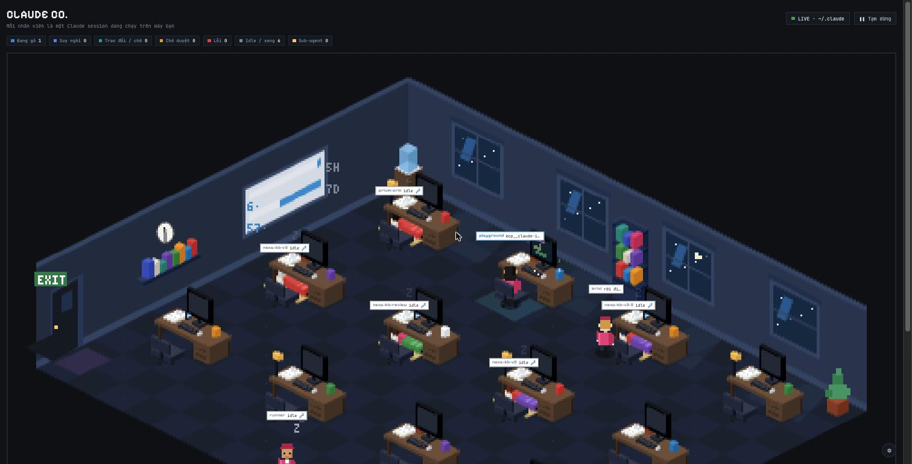
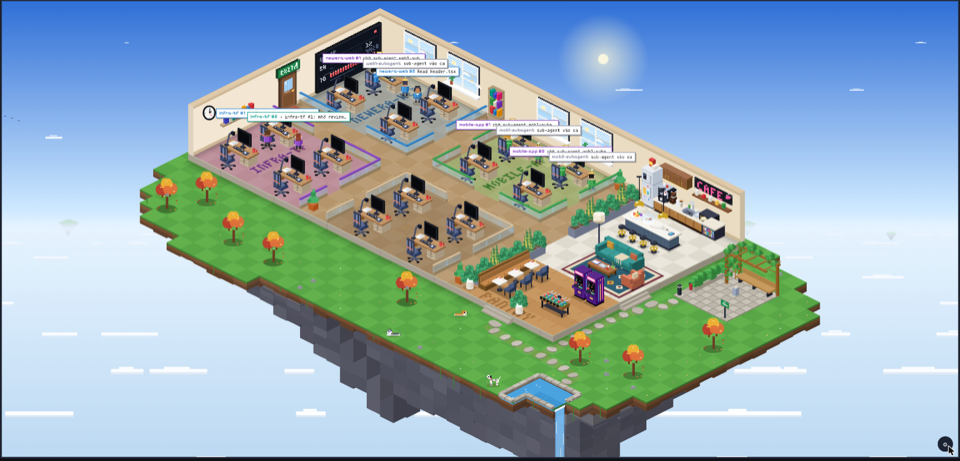
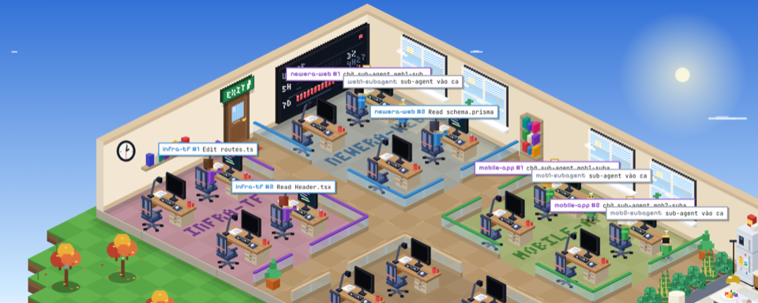
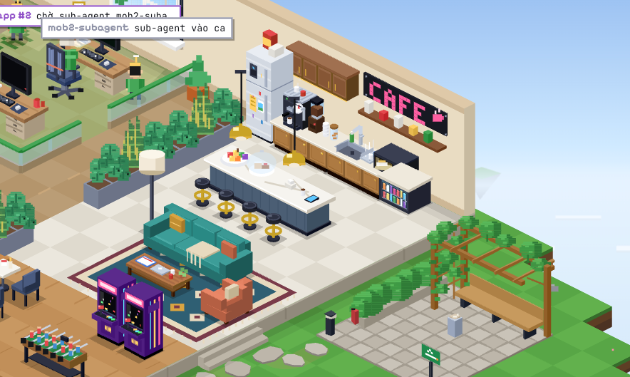
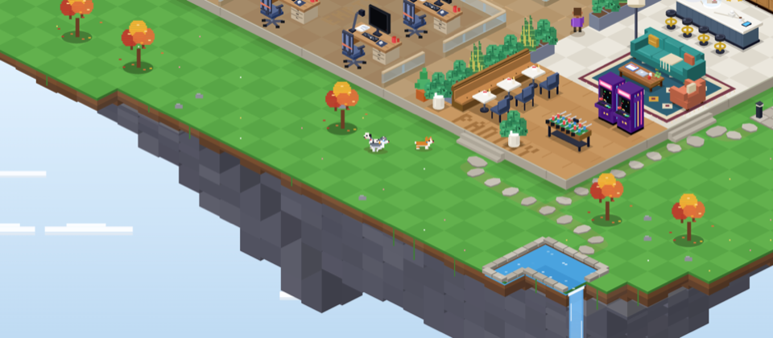
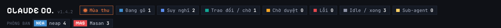

<p align="center">
  <h1 align="center">🏢 ai-terrarium</h1>
  <p align="center">
    <strong>Watch your AI agents work in a pixel-art terrarium.</strong>
  </p>
  <p align="center">
    <a href="#-quick-start">Quick Start</a> ·
    <a href="#-features">Features</a> ·
    <a href="#%EF%B8%8F-configuration">Configuration</a> ·
    <a href="https://claude.ai/artifact/7rKQWsQxG8WttUXiWqEUt6?server=localhost:4317">Live Demo</a>
  </p>
  <p align="center">
    <a href="https://github.com/luanle912/ai-terrarium/stargazers"></a>
    <a href="LICENSE"></a>
    
    
    
  </p>
</p>

<br>

<p align="center">
  
</p>

<br>

Each active **Claude Code session** becomes an animated character sitting at a desk in an isometric pixel-art office — on a floating sky island, above a sea of clouds. Day and night follow your real clock, weather changes on its own, and three office dogs roam the lawn.

---

## ⚡ Quick Start

**One command** at the Claude Code prompt:

```
/plugin install ai-terrarium --marketplace luanle912/ai-terrarium
```

Open your browser → **http://localhost:4317** — that's it.

> The server starts automatically with every new Claude Code session. No config needed.

---

## ✨ Features

### The Office

<p align="center">
  
</p>

| | Feature | Description |
|---|---------|-------------|
| 🏝️ | **Sky island** | The office floats on an island with a grassy lawn, a pond with a waterfall that falls into the clouds, trees, rocks and flowers |
| 🌅 | **Day/night cycle** | Smooth lighting with cosine interpolation based on your local clock — warm dawn and dusk, stars and moon at night, desk lamps glow after dark |
| 🌦️ | **Weather** | Clear, cloudy, rain, storm, snow and fog — random every 20–40 min, or synced to the real weather of a city you choose via Open-Meteo. Rain runs down the windows, storms darken the office with lightning, snow whitens the lawn and ices the pond |
| 🎄 | **Seasonal events** | Vietnamese holidays and seasons get their own event tree on the lawn — Tết mai blossoms, Christmas tree with blinking lights, Halloween pumpkins, cherry blossoms in spring, and more |
| 🐕 | **Office dogs** | A corgi, a husky and a dalmatian roam the lawn: they stroll, drink at the pond, chase each other, greet people who come outside and sleep together under a tree at night |

### Sessions & Agents

<p align="center">
  
</p>

| | Feature | Description |
|---|---------|-------------|
| 🔌 | **Zero setup** | Installs as a Claude Code plugin — server auto-starts on `session.start` |
| ⚡ | **Real-time** | Sessions appear and disappear as you open and close Claude Code |
| 🔍 | **Session status** | See who's working, thinking, waiting for permission, talking, or idle — monitors show the current activity (code editor, terminal, reading, thinking) |
| 🏢 | **Departments** | Sessions are grouped by working directory into up to four department zones with labelled floors |
| 🤖 | **Sub-agents** | Child agents appear as smaller desks next to their parent |
| 💤 | **Vacant desks** | Unclaimed desks look greyed out; empty departments show an EMPTY label |

### Pantry & Outdoors

<p align="center">
  
  &nbsp;&nbsp;
  
</p>

| | Feature | Description |
|---|---------|-------------|
| 🍳 | **Modern kitchen** | A full pantry with fridge, espresso machine, grinder, sink, dishwasher, microwave, drinks cooler and sorted bins along the back wall |
| 🪑 | **Break seating** | A wooden bench with tables, a sky-view bar with high stools, and a bar-height island — agents on a break heat food, snack, or watch the clouds |
| 🚬 | **Smoking corner** | A paved corner on the east lawn with a bench under a vine-covered pergola, an ash bin, a planted screen toward the pantry, and a light at the entrance |
| 🛤️ | **Lawn paths** | Stepping-stone paths run from both flights of stairs to the pond and the smoking corner; agents follow them instead of cutting across the grass |
| 🏊 | **Pond bathing** | Idle agents can walk down to the pond and bathe — shown up to the shoulders with ripples around them |

### Interaction & Display

<p align="center">
  
</p>

| | Feature | Description |
|---|---------|-------------|
| 🔎 | **Pan & zoom** | Drag to pan, scroll or pinch to zoom 1×–4×; works on desktop and touch screens |
| 📱 | **Phone layout** | Responsive design that fits phone screens — compact header, scrollable status strip, smaller bubbles |
| 💬 | **Speech bubbles** | Agents show what they're doing in speech bubbles above their heads |
| 📊 | **Whiteboard** | A wall-mounted board showing real Claude API usage (5-hour and 7-day quotas) |
| 🔒 | **Private** | Reads local transcripts only; nothing leaves your machine unless you turn on Real weather, which sends the city name to Open-Meteo |
| 📦 | **Zero dependencies** | Pure Node.js — no `npm install`, no build step |

---

## 🔧 How It Works

```
~/.claude/projects/**/*.jsonl  →  SSE Server :4317  →  Pixel-Art Canvas
       (transcripts)               (Node.js)           (HTML5 Canvas)
```

The plugin hooks into `session.start` and spawns a lightweight Node.js server:

1. **Reads** Claude Code transcript files from `~/.claude/projects/`
2. **Detects** session state — active, idle, thinking, permission, error
3. **Streams** state via Server-Sent Events to the browser
4. **Renders** each session as an animated character at an isometric desk

---

## 🖥️ Alternative: Run Without Plugin

Don't want to install the plugin? Run the server standalone:

```bash
git clone https://github.com/luanle912/ai-terrarium.git
node ai-terrarium/server.js
# → http://localhost:4317
```

Or use the **hosted UI** pointed at your local server:

```
https://claude.ai/artifact/7rKQWsQxG8WttUXiWqEUt6?server=localhost:4317
```

---

## ⚙️ Configuration

| Variable | Default | Description |
|----------|---------|-------------|
| `PORT` | `4317` | Server port |
| `CLAUDE_DIR` | `~/.claude/projects` | Transcript directory |
| `ACTIVE_MIN` | `120` | Minutes before a session is considered inactive |

### Weather

Open the ⚙ panel in the bottom-right corner of the office:

- **Thời tiết** picks the mode: *Ngẫu nhiên* (random, the default), *Thời tiết thật* (real weather) or *Tắt* (always clear).
- *Thời tiết thật* asks for a city. The page looks it up with [Open-Meteo](https://open-meteo.com/) (free for non-commercial use, no key) and refreshes every 15 minutes. If the lookup fails, the panel says why and the page falls back to random weather.
- The preview buttons (*Quang, Mây, Mưa, Giông, Tuyết, Sương*) show a weather right away.
- The mode and city are remembered in this browser. With "reduce motion" turned on in your OS, lightning does not flash and rain and snow are lighter.

---

## 🏝️ Chia sẻ đảo

Nhân viên newera.inc có thể đưa đảo của mình lên một bầu trời chung (hub). Chỉ trạng thái đã lọc rời khỏi máy: không có
nội dung, đường dẫn hay tên agent. Mức Cơ bản gửi thêm tên tool và model; tên project chỉ gửi khi bạn chọn
(xem `docs/hub-setup.md`).

```bash
node server.js join https://terrarium.newera.inc   # Pair this machine; approve the code in your browser
node server.js share kin|co-ban                    # Set the share level (Private or Basic)
node server.js private on|off                      # Hide or show your agents to others
node server.js status                              # Show the current hub connection and settings
node server.js leave                               # Revoke this device on the hub and remove the local config
```

Trên trang của hub, ở chế độ **Của tôi** và trang `/me`, bạn tự đổi tên và màu đảo, xem và thu hồi từng máy, và rời hub
(xoá đảo, máy, phiên). Trang local có công tắc **Xem như người khác** trong Cài đặt để xem đúng phần người khác thấy,
kể cả khi chưa ghép máy. Owner của hub có thêm quyền "Xoá đảo" của một member. Người nghỉ việc mất quyền trong vòng
24 giờ, tự động (hub dùng quyền truy cập offline của Google, nên lần đăng nhập đầu có màn hình đồng ý).

Hướng dẫn dựng hub và biến môi trường: [docs/hub-setup.md](docs/hub-setup.md).

---

## 📊 Hiện mức dùng 5H/7D

Bảng **USAGE** trên tường lấy số liệu từ statusLine của Claude Code (Claude Code không còn ghi file usage nào khác). Thêm một lần vào `~/.claude/settings.json`:

```json
"statusLine": { "type": "command", "command": "node <đường dẫn plugin>/server.js statusline" }
```

Nếu bạn đã có status line riêng, giữ nó bằng `--chain`:

```json
"statusLine": { "type": "command", "command": "node <đường dẫn plugin>/server.js statusline --chain \"<lệnh cũ>\"" }
```

Lệnh ghi `~/.claude-terrarium/usage.json` (quyền 0600) và in một dòng như `🏝 5H 23% · 7D 41%`. Khi chưa có dữ liệu, bảng hiện `--` thay vì 0%.
Chỉ chạy được với gói Pro/Max của claude.ai, Claude Code ≥ 2.1.80, và sau phản hồi đầu tiên của mỗi phiên.

## 🔄 Update

```
claude plugin update ai-terrarium
```

---

## 📋 Requirements

- **Node.js 18+** — check with `node -v`
- **Claude Code 2.1+**

---

## 📄 License

[MIT](LICENSE)

---

<p align="center">
  <sub>Built with ❤️ for the Claude Code community</sub>
  <br>
  <sub>If you find this useful, a ⭐ would be much appreciated!</sub>
</p>
