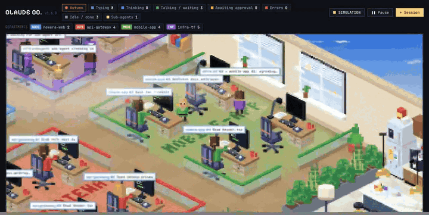

<p align="center">
  <h1 align="center">🏢 ai-terrarium</h1>
  <p align="center">
    <strong>Watch your AI agents work in a pixel-art terrarium.</strong>
  </p>
  <p align="center">
    <a href="#-quick-start">Quick Start</a> ·
    <a href="#-features">Features</a> ·
    <a href="#%EF%B8%8F-configuration">Configuration</a> ·
    <a href="https://github.com/luanle912/ai-terrarium/releases">Releases</a>
  </p>
  <p align="center">
    <a href="https://github.com/luanle912/ai-terrarium/stargazers"></a>
    <a href="LICENSE"></a>
    
    
    
  </p>
</p>

<br>

<p align="center">
  
  <br>
  <sub>Simulation mode (⚙ → Data source) — the departments and sessions are made up</sub>
</p>

<br>

Each active **Claude Code session** becomes an animated character sitting at a desk in an isometric pixel-art office — on a floating sky island, above a sea of clouds. Day and night follow your real clock, weather changes on its own, and three office dogs roam the lawn.

---

## ⚡ Quick Start

**One command** at the Claude Code prompt:

```
/plugin install ai-terrarium --marketplace luanle912/ai-terrarium
```

Open your browser → **http://localhost:4317** — that's it.

> The server starts automatically with every new Claude Code session. No config needed.

---

## ✨ Features

### The Office

<p align="center">
  
</p>

| | Feature | Description |
|---|---------|-------------|
| 🏝️ | **Sky island** | The office sits in the middle of a hexagon island with a wavy shore and stacked stone blocks underneath: two low-poly peaks behind it with a fall into a small pool, a big lake at the bottom point with a one-pillar pavilion, lotus, duckweed, ducks and fish, a waterfall over the edge into the clouds, lamps, groves, a rest corner with a bench and a fishing spot by the lake, and small floating islands in the distance |
| 🌅 | **Day/night cycle** | Smooth lighting with cosine interpolation based on your local clock — warm dawn and dusk, stars and moon at night, desk lamps glow after dark |
| 🌦️ | **Weather** | Clear, cloudy, rain, storm, snow and fog — random every 20–40 min, or synced to the real weather of a city you choose via Open-Meteo. Rain runs down the windows, storms darken the office with lightning, snow whitens the lawn and the peaks, and a rainbow follows the rain |
| 🎄 | **Seasonal events** | Vietnamese holidays and seasons get their own event tree on the lawn — Tết mai blossoms, Christmas tree with blinking lights, Halloween pumpkins, cherry blossoms in spring, and more |
| 🐕 | **Office dogs** | A corgi, a husky and a dalmatian roam the lawn: they stroll, drink at the lake, chase each other, greet people who come outside and sleep together under a tree at night |

### Sessions & Agents

<p align="center">
  
</p>

| | Feature | Description |
|---|---------|-------------|
| 🔌 | **Zero setup** | Installs as a Claude Code plugin — server auto-starts on `session.start` |
| ⚡ | **Real-time** | Sessions appear and disappear as you open and close Claude Code |
| 🔍 | **Session status** | See who's working, thinking, waiting for permission, talking, or idle — monitors show the current activity (code editor, terminal, reading, thinking) |
| 🏢 | **Departments** | Sessions are grouped by working directory into up to four department zones with labelled floors |
| 🤖 | **Sub-agents** | Child agents appear as smaller desks next to their parent |
| 💤 | **Vacant desks** | Unclaimed desks look greyed out; empty departments show an EMPTY label |

### Pantry & Outdoors

<p align="center">
  
  &nbsp;&nbsp;
  
</p>

| | Feature | Description |
|---|---------|-------------|
| 🍳 | **Modern kitchen** | A full pantry with fridge, espresso machine, grinder, sink, dishwasher, microwave, drinks cooler and sorted bins along the back wall |
| 🪑 | **Break seating** | A wooden bench with tables, a sky-view bar with high stools, and a bar-height island — agents on a break heat food, snack, or watch the clouds |
| 🚬 | **Smoking corner** | A paved corner on the east lawn with a bench under a vine-covered pergola, an ash bin, a planted screen toward the pantry, and a light at the entrance |
| 🛤️ | **Lawn paths** | Stepping-stone paths run from both flights of stairs down to the lake and the rest corner on its bank, and to the smoking corner; agents follow them instead of cutting across the grass |
| 🏊 | **Lake bathing, bench and fishing** | Idle agents can walk down to the lake and bathe — shown up to the shoulders with ripples around them — or sit on the stone bench by the lake or fish |

### Interaction & Display

<p align="center">
  
</p>

| | Feature | Description |
|---|---------|-------------|
| 🔎 | **Pan & zoom** | Drag to pan, scroll or pinch to zoom 1×–4×; works on desktop and touch screens |
| 📱 | **Phone layout** | Responsive design that fits phone screens — compact header, scrollable status strip, smaller bubbles |
| 💬 | **Speech bubbles** | Agents show what they're doing in speech bubbles above their heads |
| 📊 | **Whiteboard** | A wall-mounted board showing real Claude API usage (5-hour and 7-day quotas) |
| 🔒 | **Private** | Reads local transcripts only; nothing leaves your machine unless you turn on Real weather, which sends the city name to Open-Meteo |
| 📦 | **Zero dependencies** | Pure Node.js — no `npm install`, no build step |

---

## 🔧 How It Works

```
~/.claude/projects/**/*.jsonl  →  SSE Server :4317  →  Pixel-Art Canvas
       (transcripts)               (Node.js)           (HTML5 Canvas)
```

The plugin hooks into `session.start` and spawns a lightweight Node.js server:

1. **Reads** Claude Code transcript files from `~/.claude/projects/`
2. **Detects** session state — active, idle, thinking, permission, error
3. **Streams** state via Server-Sent Events to the browser
4. **Renders** each session as an animated character at an isometric desk

### Project layout

Still no build step and no dependencies: the browser runs the ES modules in `web/` as they are.

| Path | What it is |
|------|------------|
| `server.js`, `lib/` | The local server (transcripts → SSE) and the publisher that sends your island to a hub |
| `hub/` | The optional multi-island hub |
| `claude-office.html` | A short shell page that loads `web/main.js` |
| `web/main.js` | Entry point: imports every module in a fixed order, then mounts the page |
| `web/*-logic.js` | DOM-free logic (sky, camera, dogs, people, restroom, bubbles, world layout); `tests/` imports each one |
| `web/office.js`, `web/office-*.js` | The page component: `office.js` holds the class, each `office-*.js` adds its methods with `mixin(ClaudeOffice, class { ... })` (agents, drawing, header, panels, settings) |
| `web/world-*.js` | World mode (several islands from a hub) and the World section of ⚙ Settings |
| `web/island-*.js`, `sky-*.js`, `decor-*.js`, `pantry-*.js`, `season-*.js` | The island (its land as data, its still art, what moves on it) and drawing: sky, office decor, pantry pieces, event trees |
| `web/i18n.js`, `web/i18n/<lang>.js` | `tr()` and one translation table per language; `tests/i18n.test.mjs` checks they match |

Each module imports exactly what it uses. After editing `web/`, run `npx prettier@3.3.3 --write web` (settings in `.prettierrc.json`); `tests/web-style.test.mjs` keeps files under 700 lines and lines under 120 characters. After pulling a new version, restart `node server.js`: an older server does not know about `web/` and the page says so.

---

## 🖥️ Alternative: Run Without Plugin

Don't want to install the plugin? Run the server standalone:

```bash
git clone https://github.com/luanle912/ai-terrarium.git
node ai-terrarium/server.js
# → http://localhost:4317
```

After a `git pull`, restart `node server.js` so it serves the new page.

---

## ⚙️ Configuration

| Variable | Default | Description |
|----------|---------|-------------|
| `PORT` | `4317` | Server port |
| `CLAUDE_DIR` | `~/.claude/projects` | Transcript directory |
| `ACTIVE_MIN` | `120` | Minutes before a session is considered inactive |

### Language

The page is available in Tiếng Việt, English, 日本語, 한국어, 简体中文, Español and ไทย. It starts in your browser's language (English if it is not one of these); pick another under **Language** at the top of the ⚙ panel and the page reloads in it and remembers the choice. The hub sign-in pages and the `server.js` command-line messages are still Vietnamese.

### Weather

Open the ⚙ panel in the bottom-right corner of the office:

- **Weather** picks the mode: *Random* (the default), *Real weather* or *Off (always clear)*.
- *Real weather* asks for a city. The page looks it up with [Open-Meteo](https://open-meteo.com/) (free for non-commercial use, no key) and refreshes every 15 minutes. If the lookup fails, the panel says why and the page falls back to random weather.
- The preview buttons (*Clear, Cloudy, Rain, Storm, Snow, Fog*) show a weather right away.
- The mode and city are remembered in this browser. With "reduce motion" turned on in your OS, lightning does not flash and rain and snow are lighter.

---

## 🏝️ Chia sẻ đảo

Ai có tài khoản Google cũng đưa được đảo của mình lên bầu trời chung tại **https://terrarium.openlabs.click**.
Chỉ trạng thái đã lọc rời khỏi máy: không có nội dung, đường dẫn hay tên agent. Mức Cơ bản gửi thêm tên tool và model;
tên project chỉ gửi khi bạn chọn.

**Tham gia:** mở ⚙ Cài đặt ở góc phải dưới trang `http://localhost:4317`, mục **Thế giới**, bấm **Tham gia thế giới**.
Trang hub mở ra với mã đã điền sẵn: đăng nhập Google (lần đầu) rồi bấm **Cho phép**. Vài giây sau đảo của bạn xuất hiện
và chip "Thế giới" trên header chuyển xanh; bấm chip để mở thế giới. Muốn rút ra thì bấm **Thoát thế giới** trong cùng mục.

**Máy này đang gửi thế nào?** Dưới dòng "đã tham gia" trong mục **Thế giới** có ô **Máy này**: trạng thái (đang gửi,
đang kết nối, riêng tư, mất kết nối, hub từ chối, máy khác đang gửi, chờ đăng nhập lại hub, bị thu hồi), "gửi lúc …"
của lần gửi cuối, lỗi cuối (mã lỗi như `network:ECONNREFUSED` hay `timeout`, số lần thất bại; thời gian chờ chỉ hiện khi
đã hẹn thử lại, "đang thử lại" khi đến lúc, và không hiện gì khi đang chờ bạn đăng nhập lại) và nút **Nhật ký** mở 50
dòng gần nhất của publisher. Gói bị hub từ chối hiện đỏ "hub từ chối" kèm lý do (ví dụ `duplicate id`). Nếu server
local không trả lời, chip "Thế giới" chuyển xám thay vì biến mất. Server cũ không có nhật ký thì ô chỉ có trạng thái.

Trang thế giới có chip kết nối với nút **?** giải thích ba trạng thái: xám **Đảo offline** (máy của một đảo ngừng
gửi: đảo mờ dần từ 45 giây, ghi "gửi lúc …", offline sau 90 giây), vàng **Đang kết nối lại** (trang mất luồng từ hub
và tự nối lại, mọi đảo tạm mờ), đỏ **Hub không phản hồi** (hub không trả lời, từ chối hoặc đang bận; trang tự thử
lại). Trong **Của tôi**, máy bạn đang dùng có nhãn "Máy này" và giờ gửi cuối.

Trang local có công tắc **Xem như người khác** trong Cài đặt để xem đúng phần người khác thấy, kể cả khi chưa tham gia.
Trên hub, ở chế độ **Của tôi** và trang `/me`, bạn đổi tên và màu đảo, xem và thu hồi từng máy, hoặc rời hub.

Vẫn dùng được từ terminal:

```bash
node server.js join https://terrarium.openlabs.click   # Pair this machine; approve it in your browser
node server.js share kin|co-ban                         # Set the share level (Private or Basic)
node server.js private on|off                           # Hide or show your agents to others
node server.js status                                   # Show the current hub connection and settings
node server.js leave                                    # Revoke this device on the hub and remove the local config
```

Owner của hub có thêm quyền "Xoá đảo" của một member. Người nghỉ việc mất quyền trong vòng 24 giờ, tự động
(hub dùng quyền truy cập offline của Google, nên lần đăng nhập đầu có màn hình đồng ý).

**Bầu trời 8 đảo.** Một hub chứa tối đa 8 đảo, mỗi đảo một chỗ cố định. Ở **Toàn cảnh**, đảo của bạn nằm **giữa**, to hơn
một chút, 7 chỗ còn lại xếp vòng quanh (đảo offline mờ đi nhưng giữ chỗ, chỗ chưa ai dùng ghi "chỗ trống"). Không kéo,
không zoom. **Bấm một đảo** để vào xem (mây khép rồi mở), nút **← Toàn cảnh** hoặc phím **Esc** để ra. Chưa có đảo thì ô
giữa là "chỗ của bạn" (bấm để xem cách ghép máy); hub đủ 8 đảo thì ô giữa ghi "Hub đã đủ 8 đảo" và `join` báo
`the hub is full (8 islands)`: nhờ owner "Xoá đảo" bớt một đảo để lấy chỗ. Trên điện thoại, đảo của bạn ở trên cùng, các
đảo còn lại xếp hai cột bên dưới.

Muốn dựng hub riêng (giới hạn theo tên miền công ty, owner, sao lưu): [docs/hub-setup.md](docs/hub-setup.md).
Đặt `TERRARIUM_HUB=<url>` để nút Tham gia trỏ về hub của bạn.

---

## 📊 Hiện mức dùng 5H/7D

Bảng **USAGE** trên tường lấy số liệu từ statusLine của Claude Code (Claude Code không còn ghi file usage nào khác). Thêm một lần vào `~/.claude/settings.json`:

```json
"statusLine": { "type": "command", "command": "node <đường dẫn plugin>/server.js statusline" }
```

Nếu bạn đã có status line riêng, giữ nó bằng `--chain`:

```json
"statusLine": { "type": "command", "command": "node <đường dẫn plugin>/server.js statusline --chain \"<lệnh cũ>\"" }
```

Lệnh ghi `~/.claude-terrarium/usage.json` (quyền 0600) và in một dòng như `🏝 5H 23% · 7D 41%`. Khi chưa có dữ liệu, bảng hiện `--` thay vì 0%.
Chỉ chạy được với gói Pro/Max của claude.ai, Claude Code ≥ 2.1.80, và sau phản hồi đầu tiên của mỗi phiên.

## 🔄 Update

```
claude plugin update ai-terrarium
```

---

## 📋 Requirements

- **Node.js 18+** — check with `node -v`
- **Claude Code 2.1+**

---

## 📄 License

[MIT](LICENSE)

---

<p align="center">
  <sub>Built with ❤️ for the Claude Code community</sub>
  <br>
  <sub>If you find this useful, a ⭐ would be much appreciated!</sub>
</p>
